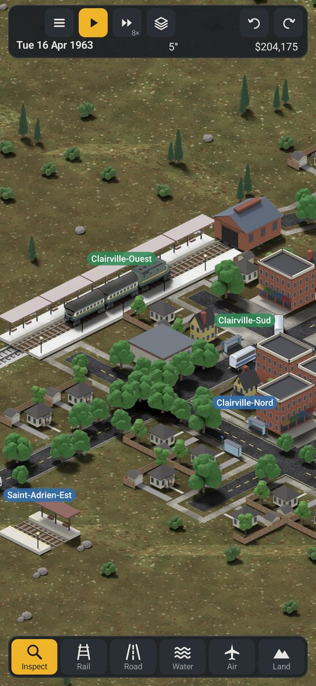
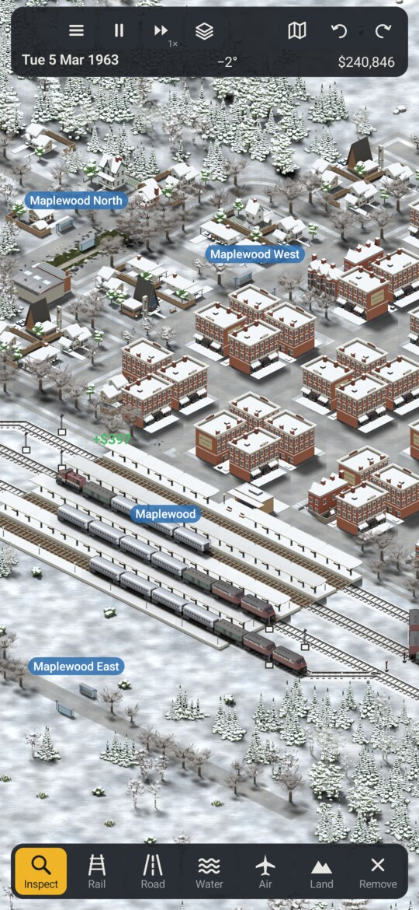
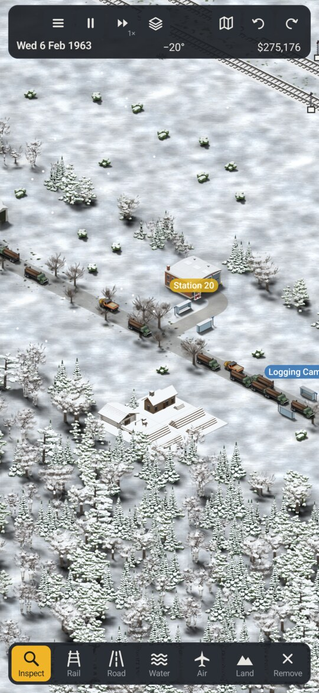
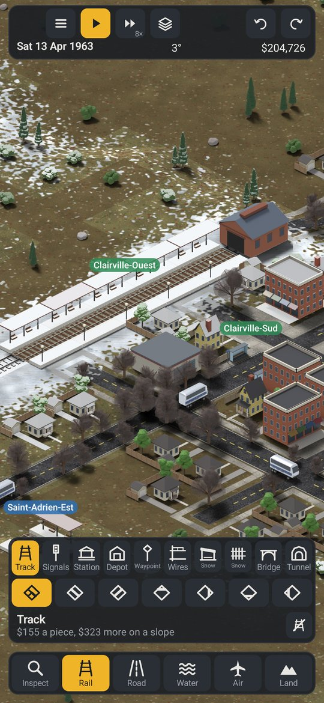
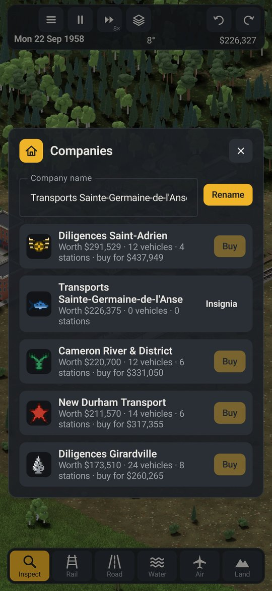
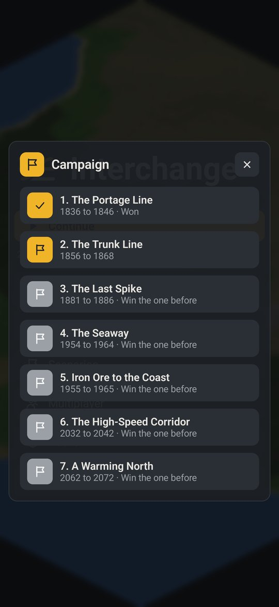

# Interchange

Interchange is a transport game for Android 8.1+ based on OpenTTD.

Move goods and people via rail, road, water, and ait. Build your company up over time, upgrade your vehicles, make complicated rail networks and fight your way through the weather. Play against computer rivals and/or other human players - or play with other people as the same company.

There's a campaign of seven chapters from 1836 on, goals to play for in your own games, and a scenario editor to make your own.

Currently the game is playable but not finished. Build things, run trains into each other, tell me what works and what doesn't.

Join me in the #interchange channel **[on my discord](https://discord.gg/9Wun47jGC6)** to discuss the game or report any bugs.
<br>You can also add an issue here for me to look at.

Enjoy!
Dan

---

## Screenshots

<table>
  <tr>
    <td align="center" width="33%"></td>
    <td align="center" width="33%"></td>
    <td align="center" width="33%"></td>
  </tr>
  <tr>
    <td align="center" width="33%"></td>
    <td align="center" width="33%"></td>
    <td align="center" width="33%"></td>
  </tr>
</table>

---

## What's in it

Six regions: mixed, prairies, Canadian Shield, Rockies, Maritimes and the north. The weather comes from a real town in that region. Towns are named in English or French depending on where they are, and they grow. Snow piles up and drifts, trains get stuck in it, lakes freeze over, the ground heaves in the spring and track washes out. Later on it's warmer than in 1900.

Trains have grades and grip, bridges and tunnels, wires, and snow plows for the drifts. Drag along a line to signal it, path signals and presignals, and turn on the overlay to see what track a train has claimed. Leave the signals out and trains run into each other, as in OpenTTD. You can turn crashes off. Engines and cars from the 1830s on.

Roads from dirt tracks to highways, one-way roads, trams, buses and trucks. Horse-drawn wagons and coaches early on, winter tires, salt and plows later. Level crossings flash when a train's coming. Don't let traffic queue across them. Canals and locks, ferries, lakers and icebreakers, strips, seaplane bases and airports, and bush planes on floats and skis with the seasons.

Logging camps, farms, mines, mills, oil sands and ports. Loans, subsidies, company value and a league table. Autorenew replaces your vehicles as they get old. Up to 7 computer companies run buses, trucks and railways. They open routes, give them up, and go under when they can't pay their way. Buy one outright, or pick up one that's in trouble. Name your company and give it an insignia, one of 24 or one you draw, in your company's colour. At the town hall you can advertise, fund new buildings, put up a statue, do road works or buy exclusive rights.

Goals to grow towns, carry cargo and build the company up. The campaign runs from 1836 to 2072, and there's a scenario editor for your own. The chronicle keeps the news, and you can read back through it. Slow the days down, up to 16 times, so vehicles get more done in a year. Vehicles, buildings and industries come from packs, and you can make your own. The spec is in [packs/SPEC.md](packs/SPEC.md), with a template in [packs/template](packs/template).

---

## Playing together

Everyone plays the same game, so building, vehicles and money are the same on every phone. Start your own company, share one, or watch.

In a game, open the menu, then Multiplayer, then Open to players. You can set a password. The game keeps running in the background, and the notification has a button to stop.

From the title screen, Multiplayer lists the games on your network. Pick one, then start a company, join one or watch. You can also join by address. Packs you don't have are sent when you join. Set a company password in the Players window to keep others out. Chat is the button in the top bar.

### Running a server

A dedicated server keeps the game going with nobody playing. Easily run with docker:

```sh
cp .env.example .env        # set ADMIN_PASSWORD
docker compose up --build
```

Players on your network find it by themselves. The admin page is at `http://<this machine>:8088`. From there you can pause, change the speed, chat, kick, save or start a new game. Settings are in [dedicated/README.md](dedicated/README.md).

---

## Installing

Download the signed APK from [GitHub releases](https://github.com/roge-rm/Interchange/releases/latest), or add [my F-Droid repo](https://hunke.ws/fdroid/repo) to your F-Droid client and install Interchange from there.

## Building it

You need a JDK (21 or newer) and the Android SDK.

```sh
./gradlew :app:assembleDebug        # the app
./gradlew :app:assembleFast         # the app, as quick as a release, debug-signed
./gradlew :sim:jvmTest              # the game's tests
./gradlew :dedicated:installDist    # the server, without docker
```

## How it's laid out

| | |
|---|---|
| `sim` | the game itself: the world, towns, vehicles, weather and rivals, with no screen |
| `server` | runs a game on its own thread, for hosting and joining |
| `net` | messages and connections between players |
| `shared` | the screen, in Compose Multiplatform |
| `app` | the Android app |
| `dedicated`, `web-admin`, `docker` | the dedicated server and its admin page |
| `packs`, `packtool` | the base pack, the pack spec and template, and the tool that checks packs |
| `tools` | Blender scripts that render the art, and the tool that packs it into sheets |

## Licence

GPL 3.0. See [LICENSE](LICENSE).
